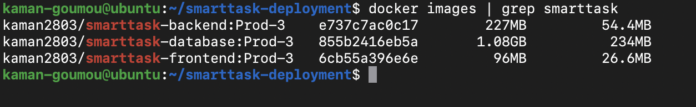
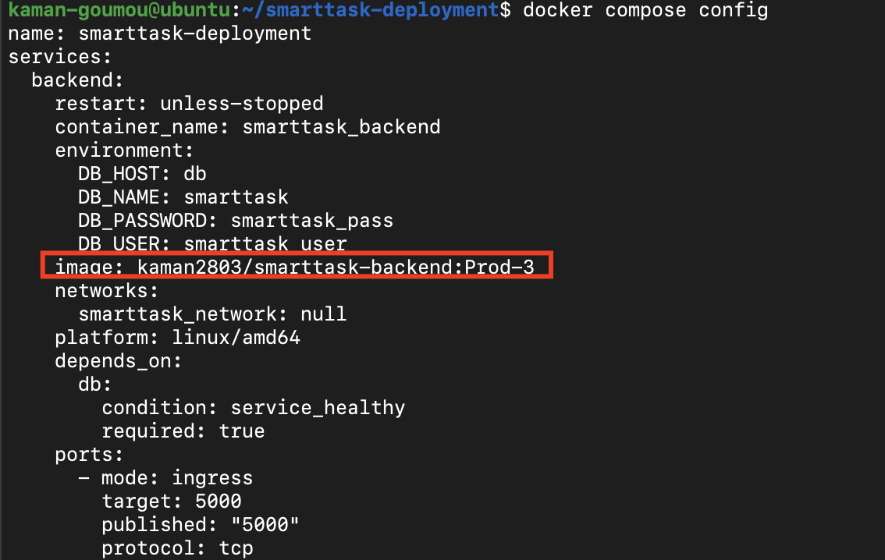
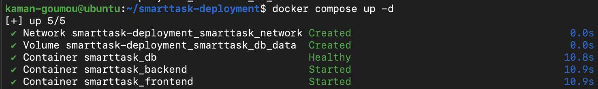
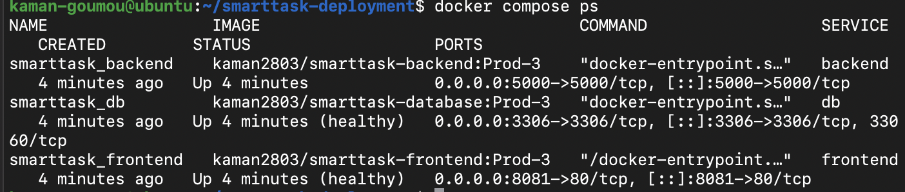
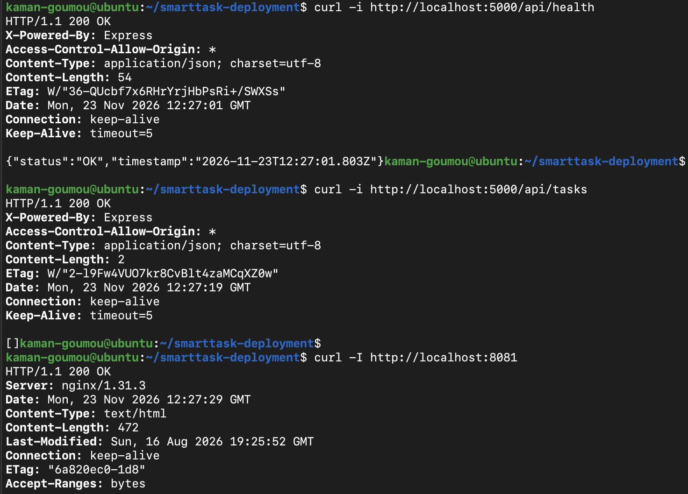
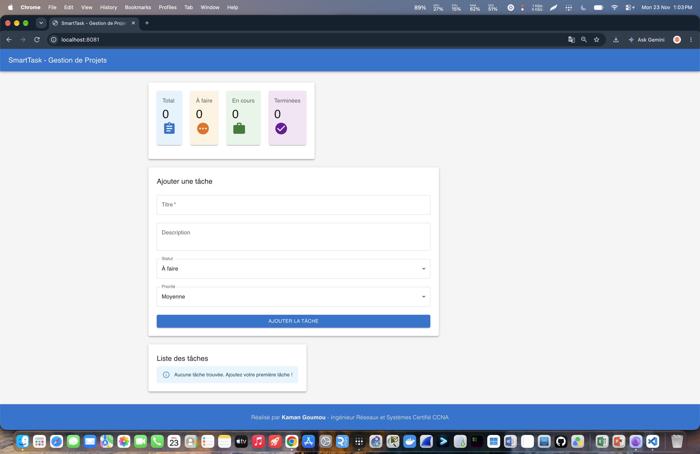

# SmartTask — Déploiement avec Docker Compose

[](https://www.docker.com/)
[](https://www.mysql.com/)
[](https://www.docker.com/)

## 1. Présentation du projet

Ce document retrace les différentes étapes réalisées pour déployer **SmartTask – Gestion de Projets** à partir des images Docker publiées sur Docker Hub.

Le déploiement repose sur Docker Compose et comprend trois composants :

- **Frontend** : interface web de gestion des tâches.
- **Backend** : API REST développée avec Node.js et Express.
- **Database** : base de données MySQL.

### Projet source

[SmartTask DevOps — Dépôt GitHub](https://github.com/kaman2803/smarttask-devops)

### Images Docker utilisées

| Composant | Image Docker | Tag |
|---|---|---|
| Frontend | `kaman2803/smarttask-frontend` | `Prod-3` |
| Backend | `kaman2803/smarttask-backend` | `Prod-3` |
| Database | `kaman2803/smarttask-database` | `Prod-3` |

---

## 2. Environnement de déploiement

Le déploiement a été réalisé sur un environnement Mac Apple Silicon (M1), avec Docker et Docker Compose.

Les images utilisées ne proposant pas de manifeste compatible avec l'architecture native `linux/arm64/v8`, nous avons explicitement sélectionné `linux/amd64`.

Cette précision est nécessaire pour télécharger et exécuter les images sur cet environnement.

## 3. Téléchargement des images Docker

### 3.1 Première tentative

Nous avons commencé par télécharger l'image MySQL sans préciser la plateforme :

```bash
docker pull kaman2803/smarttask-database:Prod-3
```

Docker a retourné l'erreur suivante :

```text
no matching manifest for linux/arm64/v8
```

Cette erreur indique que l'image ne dispose pas de manifeste compatible avec la plateforme ARM64 demandée.

### 3.2 Solution : préciser la plateforme AMD64

Nous avons relancé le téléchargement en utilisant l'option `--platform linux/amd64`.

```bash
docker pull --platform linux/amd64 kaman2803/smarttask-database:Prod-3

docker pull --platform linux/amd64 kaman2803/smarttask-backend:Prod-3

docker pull --platform linux/amd64 kaman2803/smarttask-frontend:Prod-3
```

Les trois téléchargements se sont terminés avec succès.

### 3.3 Vérification des images

```bash
docker images | grep smarttask
```

Images obtenues :

| Image | Taille |
|---|---:|
| `smarttask-backend:Prod-3` | 227 MB |
| `smarttask-database:Prod-3` | 1.08 GB |
| `smarttask-frontend:Prod-3` | 95.3 MB |

Les trois images sont désormais disponibles localement.



---

## 4. Préparation du répertoire de déploiement

Création du répertoire de travail :

```bash
mkdir -p ~/smarttask-deployment
cd ~/smarttask-deployment
```

Création des fichiers nécessaires :

```bash
touch .env docker-compose.yml
```

Structure initiale :

```text
smarttask-deployment/
├── .env
└── docker-compose.yml
```

---

## 5. Configuration des variables d'environnement

Le fichier `.env` centralise les paramètres de connexion à MySQL et ceux utilisés par le backend.

Contenu utilisé pendant le déploiement :

```env
MYSQL_ROOT_PASSWORD=rootpass
MYSQL_DATABASE=smarttask
MYSQL_USER=smarttask_user
MYSQL_PASSWORD=smarttask_pass

DB_HOST=db
DB_USER=smarttask_user
DB_PASSWORD=smarttask_pass
DB_NAME=smarttask
```

**Remarque :** ces identifiants correspondent à la configuration utilisée lors de notre déploiement. Ils sont fournis ici à titre de démonstration. Pour une utilisation réelle, définir des mots de passe robustes et personnels.

---

## 6. Configuration Docker Compose

Le fichier `docker-compose.yml` définit les trois services, leurs paramètres de démarrage, les ports publiés, le réseau et le stockage persistant.

### 6.1 Fichier docker-compose.yml

```yaml
services:
  db:
    image: kaman2803/smarttask-database:Prod-3
    platform: linux/amd64
    container_name: smarttask_db
    restart: unless-stopped
    environment:
      MYSQL_ROOT_PASSWORD: ${MYSQL_ROOT_PASSWORD}
      MYSQL_DATABASE: ${MYSQL_DATABASE}
      MYSQL_USER: ${MYSQL_USER}
      MYSQL_PASSWORD: ${MYSQL_PASSWORD}
    ports:
      - "3306:3306"
    volumes:
      - smarttask_db_data:/var/lib/mysql
    networks:
      - smarttask_network
    healthcheck:
      test: ["CMD", "mysqladmin", "ping", "-h", "localhost", "-p${MYSQL_ROOT_PASSWORD}"]
      interval: 10s
      timeout: 5s
      retries: 10

  backend:
    image: kaman2803/smarttask-backend:Prod-3
    platform: linux/amd64
    container_name: smarttask_backend
    restart: unless-stopped
    environment:
      DB_HOST: db
      DB_USER: ${DB_USER}
      DB_PASSWORD: ${DB_PASSWORD}
      DB_NAME: ${DB_NAME}
    ports:
      - "5000:5000"
    networks:
      - smarttask_network
    depends_on:
      db:
        condition: service_healthy

  frontend:
    image: kaman2803/smarttask-frontend:Prod-3
    platform: linux/amd64
    container_name: smarttask_frontend
    restart: unless-stopped
    ports:
      - "8081:80"
    networks:
      - smarttask_network
    depends_on:
      - backend

networks:
  smarttask_network:
    driver: bridge

volumes:
  smarttask_db_data:
```

### 6.2 Explication de l'architecture

| Élément | Fonction |
|---|---|
| `db` | Service de base de données MySQL |
| `backend` | Service API Node.js / Express |
| `frontend` | Interface web servie par Nginx |
| `smarttask_network` | Réseau privé de communication entre les services |
| `smarttask_db_data` | Volume persistant des données MySQL |
| `healthcheck` | Vérification de la disponibilité de MySQL |
| `depends_on` | Gestion de l'ordre de démarrage des services |

Le backend utilise le nom de service `db` pour joindre MySQL sur le réseau Docker interne.

### 6.3 Plan de publication des ports

| Service | Port hôte | Port conteneur | Utilisation |
|---|---:|---:|---|
| Frontend | 8081 | 80 | Accès à l'interface web |
| Backend | 5000 | 5000 | Accès à l'API REST |
| MySQL | 3306 | 3306 | Accès à la base de données |

### 6.4 Validation de la configuration

Avant le démarrage, nous avons vérifié la configuration :

```bash
docker compose config
```

La commande a affiché la configuration résolue sans erreur.



---

## 7. Démarrage des services

Lancement de l'ensemble de l'application en arrière-plan :

```bash
docker compose up -d
```

Résultat obtenu :

```text
[+] up 5/5
✔ Network smarttask-deployment_smarttask_network Created
✔ Volume smarttask-deployment_smarttask_db_data Created
✔ Container smarttask_db Healthy
✔ Container smarttask_backend Started
✔ Container smarttask_frontend Started
```

Les ressources suivantes ont été créées :

- Réseau `smarttask-deployment_smarttask_network`.
- Volume `smarttask-deployment_smarttask_db_data`.
- Conteneur `smarttask_db`.
- Conteneur `smarttask_backend`.
- Conteneur `smarttask_frontend`.



---

## 8. Vérification de l'état des conteneurs

Commande exécutée :

```bash
docker compose ps
```

État obtenu :

| Conteneur | Service | État | Port |
|---|---|---|---|
| `smarttask_db` | Database | Up (healthy) | 3306 |
| `smarttask_backend` | Backend | Up | 5000 |
| `smarttask_frontend` | Frontend | Up (healthy) | 8081 |

Les trois conteneurs sont démarrés.



---

## 9. Tests et vérifications techniques

Après le démarrage, nous avons effectué plusieurs tests pour vérifier la disponibilité des services.

### 9.1 Vérification de l'API Backend

Commande :

```bash
curl -i http://localhost:5000/api/health
```

Résultat :

```http
HTTP/1.1 200 OK
```

Réponse JSON :

```json
{
  "status": "OK",
  "timestamp": "2026-11-23T12:27:01.803Z"
}
```

L'API répond correctement.

### 9.2 Vérification de la liste des tâches

Commande :

```bash
curl -i http://localhost:5000/api/tasks
```

Résultat :

```http
HTTP/1.1 200 OK
```

Réponse :

```json
[]
```

L'API retourne une liste vide, ce qui correspond à une base initialement dépourvue de tâches.

### 9.3 Vérification du Frontend

Commande :

```bash
curl -I http://localhost:8081
```

Résultat :

```http
HTTP/1.1 200 OK
Server: nginx/1.31.3
Content-Type: text/html
```

Le serveur Nginx répond correctement sur le port 8081.



---

## 10. Vérification des journaux

Pour vérifier le fonctionnement interne des services, nous avons consulté leurs journaux :

```bash
docker compose logs --tail=30 db backend frontend
```

### Backend

Messages obtenus :

```text
Backend SmartTask démarré sur le port 5000
Table "tasks" vérifiée / créée avec succès dans MySQL.
```

Ces messages confirment le démarrage du backend et la vérification/création de la table `tasks`.

### MySQL

MySQL a confirmé son initialisation :

```text
MySQL Community Server - GPL.
ready for connections.
```

### Frontend

Nginx a démarré correctement et a répondu aux requêtes HTTP avec le code `200`.

---

## 11. Accès à l'application SmartTask

L'interface web est accessible à l'adresse suivante :

**http://localhost:8081**

La page d'accueil affiche les indicateurs de gestion des tâches :

- Total.
- À faire.
- En cours.
- Terminées.

Le formulaire permet de renseigner :

- Le titre de la tâche.
- Sa description.
- Son statut.
- Sa priorité.

Une création de tâche a également été testée depuis l'interface.



---

## 12. Architecture finale du déploiement

```text
                  UTILISATEUR
                       |
                       |
                Navigateur Web
                       |
                       | HTTP : 8081
                       |
              +-------------------+
              |     FRONTEND      |
              |       NGINX       |
              |    Port : 80      |
              +-------------------+
                       |
                       |
              Réseau Docker Bridge
               smarttask_network
                       |
              +-------------------+
              |      BACKEND      |
              |   Node.js/Express |
              |   Port : 5000     |
              +-------------------+
                       |
                       | DB_HOST=db
                       |
              +-------------------+
              |      MYSQL        |
              |   Port : 3306     |
              +-------------------+
                       |
                       |
              +-------------------+
              |  VOLUME PERSISTANT|
              | smarttask_db_data |
              +-------------------+
```

---

## 13. Commandes d'administration

### Vérifier les conteneurs

```bash
docker compose ps
```

### Consulter les journaux

```bash
docker compose logs -f
```

### Consulter les journaux d'un service

```bash
docker compose logs -f backend
docker compose logs -f db
docker compose logs -f frontend
```

### Arrêter les services

```bash
docker compose down
```

### Relancer les services

```bash
docker compose up -d
```

**Attention :** ne pas utiliser `docker compose down -v` sans vouloir supprimer le volume MySQL et les données qu'il contient.

---


## 14 Nettoyage de l'environnement après déploiement

Après les tests, il est possible d'arrêter et de supprimer les ressources Docker utilisées par SmartTask afin de libérer les ressources système.

### 1. Arrêter et supprimer les conteneurs

Depuis le répertoire `smarttask-deployment` :

```bash
docker compose down
```

Cette commande arrête et supprime les conteneurs ainsi que le réseau créé par Docker Compose.

### 2. Supprimer également les images Docker

Pour supprimer les conteneurs, le réseau et les images associés au projet :

```bash
docker compose down --rmi all
```

### 3. Supprimer les volumes et les données persistantes

Pour effectuer un nettoyage complet, y compris les volumes :

```bash
docker compose down --rmi all --volumes --remove-orphans
```

**Attention :** cette dernière commande supprime également le volume MySQL `smarttask_db_data` et toutes les données qu'il contient. Les tâches enregistrées dans la base de données seront définitivement perdues.

### 4. Vérifier le nettoyage

Vérifier les conteneurs :

```bash
docker compose ps -a
```

Vérifier les images SmartTask :

```bash
docker images | grep smarttask
```

Vérifier les volumes :

```bash
docker volume ls | grep smarttask
```

Vérifier les réseaux :

```bash
docker network ls | grep smarttask
```

À l'issue du nettoyage complet, aucune ressource Docker associée au déploiement SmartTask ne doit subsister.

> **Remarque :** les autres conteneurs et ressources Docker de la machine ne sont pas concernés par ces commandes, sauf s'ils sont explicitement rattachés au projet Compose.
---

## 15. Conclusion

Le déploiement de SmartTask avec Docker Compose a permis de mettre en fonctionnement les trois composants de l'application : frontend, backend et base de données MySQL.

Les vérifications ont confirmé :

- Le téléchargement des trois images Docker.
- La création du réseau et du volume persistant.
- Le démarrage des trois conteneurs.
- La disponibilité de MySQL.
- Le fonctionnement de l'API REST.
- La disponibilité du frontend via Nginx.
- L'accès à l'interface SmartTask et le test de création d'une tâche.

L'application est ainsi déployée dans un environnement Docker Compose, avec une séparation des services, un réseau dédié et un stockage persistant pour la base de données.

**Dépôt du projet :** [https://github.com/kaman2803/smarttask-devops](https://github.com/kaman2803/smarttask-devops)
